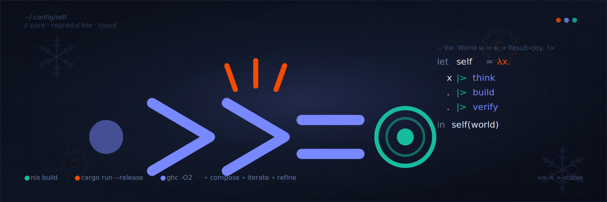
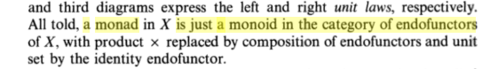

  

  Welcome to my GitHub page. This is where you can see what I'm currently working on.

  I put showcase projects on <a href="https://github.com/MPM-Labs">MPM-Labs</a>

  <a href="#who-am-i">Who am I</a> •
  <a href="#focus--concrete">Current focus</a> •
  <a href="#focus--philosophical">Philosophy</a> •
  <a href="#books">Books</a> •
  <a href="#work">Work</a> •
  <a href="#technologies-i-use-or-have-used">Tech</a>

  

## Who am I?

My name is **Jonas** and I am a software engineering student at **Oslo Metropolitan University**. I also study whatever I find interesting in the software world, either on my own or in extra courses.

I love understanding how things work, and can never stop myself from investigating something I don't understand.

In addition to attending OsloMet, I have the following roles:
- TA in DATS2300(algorithms and data structures) at OsloMet.
- "single-course" student at UiO (I attend IN2040 functional programming).

---

## Concrete focus

### Haskell

I'm learning **Haskell**. I think it offers a great (and different) perspective than most OOP languages (which are really all popular languages). I can definitely feel my brain expanding (sometimes it creaks and crackles after a particularly intense haskelling-session). In term of FP, I'm attending a course that uses **Scheme(Lisp)** too.

   
  <em>"A monad is just a monoid in the category of endofunctors."</em> 
  — Saunders Mac Lane, <em>Categories for the Working Mathematician</em> (1971)

### Rust

I'm also learning **Rust**. It's like an amalgamation of many paradigms, and in contrast to Haskell it actually has some use in industry. Great performance, support for functional style, great compiler errors. 8/10.

### Nix

Imagine if you wrote down a log of all command you ran so you could retrace your steps and reproduce your machines state at any point. That's not really what Nix does, but it does accomplish the same thing. It also does (but is not limited to):
- software packaging (by definitively identifying dependencies, guaranteeing correct deployment)
- machine configuration
- atomic updates
- reproducible devshells
- VM testing of configurations
For me, it sort of replaces Docker alltogether.

If you're curious, you should really just look at [The Map](https://vimjoyer.com/nixmap/).

<strong>🔧 My current Nix deep-dive (click to expand)</strong>

 

My [portfolio page](https://jonas.baugerud.no) uses Nix for a lot of different things (probably somewhat wrongly, so sorry if you already know Nix and this is painful to look at):

1. **Build** — The site is written in Rust using [Leptos](https://www.leptos.dev/). Nix builds the binary and all static assets reproducibly. Same inputs, same outputs, every time — like Docker, but more deterministic.
2. **Package** — The build output is wrapped in a **NixOS module** that declares exactly how to run it, with configurable options for tweaking behavior. (well, *bahaviour*, singular (port configuration I think? (The point is that it could do much more)))
3. **Test** — The module runs inside a NixOS VM, letting me validate the full server environment before it ever touches production. This also enables automated integration tests with virtual servers and clients. (So I have my own deployment tool that stores it's state in a git repo and runs with GitHub Actions. However, for various reasons, it's a steaming pile of garbage. Looking into clan.lol as a better way to manage machines, though it may be a bit extreme for my use cases)
4. **Deploy** — [My own deployment tool](https://github.com/MPM-Labs/nixos-deployment-template) handles server bootstrapping, updates, and secrets management via GitHub Actions and environment secrets. Binary caching bridges source and binary deployment, keeping build times low on resource-constrained servers.

As a bonus, Nix gives me deterministic, language-agnostic dev environments that live in the Git repo and work identically for every contributor.

**Nix is f***ing awesome.**

---

## Philosophy

I really like finding "the right" solution to a problem. What, exactly, does that mean?
Does it mean
- using the best tools?
- using pure functional programming?
- formal verification?
- denotation design?
- delivering value?
- avoiding AI?
- knowing which problem to solve in the first place?
- knowing which problem not to solve in the first place?
- communicating using DDD?
- communicating using Event Modeling?
- using Event Sourcing to implement retroactive features, assuming we don't know everything and might regret not having the option tomorrow?
I mostly have questions, but I'll let you know if I find the answers (promise!).

---

## Work

> 💼 **I'm actively looking for a job opportunity within software engineering.**

I'm especially interested in roles involving FP, Rust, devops, systems programming, or infrastructure/tooling — but I'm open to anything where correctness and craftsmanship matter.

  
  

## Books
Love'em. Currently reading the following:
[Category theory for programmers by Bartosz Milewski](https://bartoszmilewski.com/2014/10/28/category-theory-for-programmers-the-preface/).
[Programming in Haskell by Graham Hutton](https://people.cs.nott.ac.uk/pszgmh/pih.html)
[Understanding Eventsourcing by Martin Dilger](https://leanpub.com/eventmodeling-and-eventsourcing)
[SICP by Abelson and Sussmann](https://web.mit.edu/6.001/6.037/sicp.pdf)

---

## Technologies I use or have used

### 🟢 Languages I know well

<table>
  <tr>
    <td align="center" width="80"> <b>Rust</b></td>
    <td>My personal go-to. Can be used for almost anything, from low level systems to web servers. I even use it to compile WASM for my portfolio website.</td>
  </tr>
  <tr>
    <td align="center"> <b>Nix</b></td>
    <td>More tooling-oriented. I use it in all my projects. It packages software and guarantees correct deployment.</td>
  </tr>
  <tr>
    <td align="center"> <b>Bash</b></td>
    <td>Always useful.</td>
  </tr>
  <tr>
    <td align="center"> <b>PostgreSQL</b></td>
    <td>You can do remarkably powerful things with SQL and PL/pgSQL.</td>
  </tr>
  <tr>
    <td align="center"> <b>Python</b></td>
    <td>For quick prototyping and university courses.</td>
  </tr>
  <tr>
    <td align="center"> <b>Java</b></td>
    <td>The main language taught at university.</td>
  </tr>
  <tr>
    <td align="center"> <b>HTML</b></td>
    <td>Always important to keep the basics in mind.</td>
  </tr>
  <tr>
    <td align="center"> <b>CSS</b></td>
    <td>I prefer writing my own CSS (SCSS) instead of using tools like Tailwind. That being said, design is not my main focus.</td>
  </tr>
  <tr>
    <td align="center"> <b>JavaScript</b></td>
    <td>Unavoidable in web work — though I reach for Rust + WASM when I can.</td>
  </tr>
</table>

### 📚 Languages I'm learning

<table>
  <tr>
    <td align="center" width="80"> <b>Rust</b></td>
    <td>Currently working on async understanding.</td>
  </tr>
  <tr>
    <td align="center"> <b>Nix</b></td>
    <td>Currently working through chapter 5 of <a href="https://edolstra.github.io/pubs/phd-thesis.pdf">the thesis</a>.</td>
  </tr>
  <tr>
    <td align="center"> <b>Bash</b></td>
    <td>I often bump into commands I haven't used before and try to get familiar with as many as possible. (technically I use zsh)</td>
  </tr>
  <tr>
    <td align="center"> <b>Haskell</b></td>
    <td>Currently reading <a href="https://people.cs.nott.ac.uk/pszgmh/pih.html">Programming in Haskell</a> and <a href="https://bartoszmilewski.com/2014/10/28/category-theory-for-programmers-the-preface/">Category theory for programmers by Bartosz Milewski</a>.</td>
  </tr>
  <tr>
    <td align="center"> <b>WASM</b></td>
    <td>I am developing my portfolio site that runs on <a href="https://www.leptos.dev/">Leptos</a>, but would like to learn more about WASM itself.</td>
  </tr>
</table>

### 🛠️ Tooling I use

<table>
  <tr>
    <td align="center" width="80"> <b>Docker</b></td>
    <td>Mostly when collaborating with others. In my personal projects, Nix has replaced Docker.</td>
  </tr>
  <tr>
    <td align="center"> <b>Figma</b></td>
    <td>Prototyping UIs.</td>
  </tr>
  <tr>
    <td align="center"> <b>Actions</b></td>
    <td>Love this! Allows a ton of automation and free jobs on public repos.</td>
  </tr>
  <tr>
    <td align="center"> <b>Linux</b></td>
    <td>I run NixOS (btw).</td>
  </tr>
  <tr>
    <td align="center"> <b>Maven</b></td>
    <td>University work.</td>
  </tr>
  <tr>
    <td align="center"> <b>Nginx</b></td>
    <td>Or Caddy. TLS and reverse proxying between sites.</td>
  </tr>
  <tr>
    <td align="center"> <b>Postman</b></td>
    <td>Manual HTTP testing.</td>
  </tr>
  <tr>
    <td align="center"> <b>Redis</b></td>
    <td>Caching and refresh token storage.</td>
  </tr>
  <tr>
    <td align="center"> <b>Spring</b></td>
    <td>University work.</td>
  </tr>
  <tr>
    <td align="center"> <b>Vite</b></td>
    <td>We use it to build the frontend of the student association's website as well as the frontend of <a href="https://metronomicon.no">Metronomicon</a>.</td>
  </tr>
</table>

### 🎯 Tooling I want to learn

<table>
  <tr>
    <td align="center" width="80"> <b>Bevy</b></td>
    <td>Game development in Rust.</td>
  </tr>
  <tr>
    <td align="center"> <b>Neovim</b></td>
    <td>I've actually started on this with a very minimal config(<a href="https://github.com/MrProgrammerMan/nixos_config/blob/master/modules/features/neovim.nix">Found here</a>)</td>
  </tr>
</table>

### 📦 Technologies I've tried or used in the past

<table>
  <tr>
    <td align="center"> <b>K8s</b></td>
    <td>Ran my own GitHub Actions Runner Controller once (but this is a bit overkill and unnecessary).</td>
  </tr>
  <tr>
    <td align="center"> <b>Processing</b></td>
    <td>This is where I'd say I learned to program.</td>
  </tr>
  <tr>
    <td align="center"> <b>Tailwind</b></td>
    <td>Have tried it, prefer SCSS personally.</td>
  </tr>
  <tr>
    <td align="center"> <b>Arduino</b></td>
    <td>Have had some hobby interest in electronics.</td>
  </tr>
  <tr>
    <td align="center"> <b>SketchUp</b></td>
    <td>Useful for simple design, like apartment plans or simple 3D prints.</td>
  </tr>
</table>
